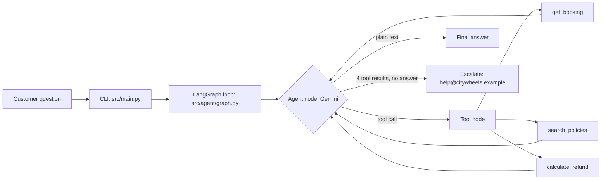

# CityWheels Help Desk Agent

A tool-calling customer-support agent for a fictional bike-rental shop (**CityWheels**). The model decides which tool to call; **every euro amount is computed in plain Python, not by the LLM**. The project ships with an offline test suite, a live evaluation harness with honest failure analysis, Docker, and CI.


> Build, run, test and evaluation details: see [SOLUTION.md](SOLUTION.md). This README is the overview.

---

## What it does

The agent answers customer questions using only the shop's own data:

| Question type | Example | Tool used |
|---|---|---|
| Shop facts | "What time do you open on Saturday?" | `search_policies` |
| Prices and rules | "Can my 14-year-old rent an e-bike?" | `search_policies` |
| Booking lookup | "What is the status of CW-1002?" | `get_booking` |
| Cancellation + refund | "I want to cancel booking CW-1002. How much will I get back?" | `get_booking` + `calculate_refund` |
| Out of scope | "What is the capital of Australia?" | none: refuses and refers to staff |

Out-of-scope questions and bad-weather refunds are not answered. The customer is sent to `help@citywheels.example`, and the answer must contain no invented amounts.

## Quick demo

```bash
docker compose run --rm agent "I want to cancel booking CW-1002. How much will I get back?"
```

At the fixed shop clock (2026-06-10 09:00 Europe/Warsaw), booking CW-1002 starts in 33 hours, so the agent calls `get_booking`, then `calculate_refund`, and answers with **340.00 EUR back to the original card within five working days**.

## Architecture



Key points:

- **One model, three tools.** On each turn the model decides whether to call a tool or answer. The code does not walk the tools in a fixed order.
- **Fixed clock.** Every customer message starts with `Current time: 2026-06-10 09:00 Europe/Warsaw`, taken from `CURRENT_TIME` in `src/config.py`. Nothing in the tools or the graph reads the system clock, so answers are reproducible.
- **Loop cap.** After four tool results without a final answer, the graph stops calling the model and sends the customer to the staff.
- **Grounding rules** (in `src/agent/prompts.py`): answer only from tool results, leave refund arithmetic to `calculate_refund`, quote a full opening-hours range when the policy gives one, include the staff email whenever the customer is referred to the staff.

## Tools

The tools live in `src/tools/` and are plain Python. They never call a model.

### `get_booking`
Loads `data/bookings.json` (money handled with `Decimal`) and returns one booking, or `Booking {id} was not found.` An unreadable file or invalid JSON returns an error string instead of crashing the process.

### `search_policies`
Splits the Markdown policy files on `##` headings, scores sections by the words in the question and returns at most three. A small alias list treats *hire/rent*, *bicycle/bike*, *ebike/electric* and *child/kid* as the same word. No match returns the staff contact.

### `calculate_refund`
Applies the cancellation bands in code, using `timedelta` thresholds rather than numbers parsed from Markdown:

| Time before start | Rental refund |
|---|---|
| 48 h or more | 100% |
| 24 h to under 48 h | 50% |
| under 24 h | 0% |

Additional rules:

- The **booking fee is never refunded**.
- The **deposit** is refunded in full only when the status is `confirmed`. For `in_progress`, `completed` and `cancelled` nothing is refunded, including the deposit.
- A **card** refund returns to the same card within five working days. A **voucher** refund is issued as a new voucher, not cash.
- Bad weather is deliberately not an amount in this function. It is a staff decision.

Verified amounts at the fixed clock: CW-1002 (card, 33 h) → 340.00 EUR; CW-1004 (voucher) → 73.00 EUR as a new voucher; CW-1005 (already cancelled) → 0.00 EUR.

## Tech stack

| Area | Tool |
|---|---|
| Language | Python 3.12 |
| Agent orchestration | LangGraph (tool-calling loop) |
| LLM client | LangChain Google GenAI chat model |
| LLM | Google Gemini, `gemini-3.5-flash-lite` (free tier), set via `MODEL_NAME` |
| Money | `decimal.Decimal` |
| Tests | `pytest` |
| Containers | Docker, Docker Compose v2 (one shared image, three services) |
| CI | GitHub Actions (`.github/workflows/tests.yml`) |
| Packaging and dependencies | `pyproject.toml` |
| AI-assisted development | Cursor (`.cursor/rules`) |

<!-- TODO: paste the exact dependency list and versions from pyproject.toml here (runtime and dev/test extras). -->

## Project layout

```
src/main.py                 command-line entrypoint
src/config.py               data paths and the fixed shop clock
src/agent/graph.py          the tool-calling loop (LangGraph)
src/agent/prompts.py        instructions for the model
src/agent/tools.py          wrappers the model is allowed to call
src/agent/evaluate.py       scores a run and writes eval/results.md
src/tools/                  booking lookup, policy search, refund math
data/policies/              prices.md, cancellations.md, faq.md
data/bookings.json          example bookings
tests/                      offline pytest suite
eval/questions.json         questions and expected outcomes
eval/run_eval.py            live evaluation entrypoint
eval/results.md             last evaluation run
Dockerfile, docker-compose.yml, .env.example
```

## Getting started

**Requirements:** Docker with Compose v2 (Docker Desktop on Windows/macOS). You do not need to install Python or any libraries locally.

```bash
cp .env.example .env        # PowerShell: Copy-Item .env.example .env
```

Set two values in `.env`, without quotes:

```
GOOGLE_API_KEY=<key from Google AI Studio>
MODEL_NAME=gemini-3.5-flash-lite
```

```bash
docker compose build
docker compose run --rm agent "How much is an e-bike for a whole day?"
docker compose run --rm test     # offline, no API key
docker compose run --rm eval     # live evaluation, needs the key
```

Notes:

- One image (`citywheels-help-desk:local`) serves the agent, the tests and the evaluation. Only the `agent` service builds it.
- A change under `src/` needs a new `docker compose build`.
- A missing `GOOGLE_API_KEY` or `MODEL_NAME` stops the process with a clear message before any call to Gemini.

## Testing

The suite runs with `pytest` **inside Docker, with no network and no API key**. The live model is only used by the `eval` service.

| Area | What is verified |
|---|---|
| Tools: `get_booking` | Existing and missing booking, unreadable file and bad JSON (using `tmp_path`) |
| Tools: `search_policies` | Section splitting, scoring, top-3 limit, alias handling (hire/rent, bicycle/bike...), no-match fallback, unreadable policy file |
| Tools: `calculate_refund` | The 24 h and 48 h boundaries, kept booking fee, voucher vs card, statuses that cannot be cancelled, unreadable policy file |
| Agent loop | Tool-calling flow with an **injected scripted model**, the fixed clock in the customer message, the four-tool-result cutoff and staff escalation |
| CLI | Missing environment variables, empty command prints usage without calling the model |
| Evaluation scorer | Scoring rules tested with the same scripted-model approach |

Development workflow: each slice (one tool, the loop, the CLI, the evaluation) was built on a short-lived branch, usually as two commits: first failing tests, then the implementation that makes them pass.

Run a single file (use forward slashes inside the container):

```bash
docker compose run --rm test tests/tools/test_policies.py
```

## Continuous integration

GitHub Actions runs `docker compose build` and `docker compose run --rm -T test` on every push and pull request. The workflow does not call the model and does not need the API key.

## Evaluation

`eval/questions.json` contains 12 questions: shop facts, one missing booking, three refunds and three refusals. The scorer in `src/agent/evaluate.py`:

- checks the **tool name** on the tool messages,
- requires every **expected fragment** in the answer,
- counts a refusal as passed only if `help@citywheels.example` is present **and** the answer contains no euro amount.

The free tier allows 15 requests per minute, so the script waits 10 s between questions and, on HTTP 429, waits 65 s and retries. A full run takes a few minutes and overwrites `eval/results.md`.

**Committed result: 10 / 12.** Both failures are strict-checker issues, not wrong customer decisions:

1. **Saturday opening hours.** The answer says "from 08:00 to 20:00" (correct), but the checker requires the policy's spelling `08:00–20:00` with an en dash.
2. **Bad-weather refund.** After a prompt tweak the model no longer opens the policy document, because the instructions already say this is a staff decision. It refers the customer to the staff with the email and invents no amount, but the checker expected the `search_policies` call.

Details and the reasoning behind stopping at 10/12 are in [SOLUTION.md](SOLUTION.md).

## Design decisions

- **Money in code, not in the LLM.** Refund amounts are computed with `Decimal` and fixed thresholds, which removes a whole class of hallucination.
- **Deterministic checks over a second model.** An LLM "reviser" could disagree with a tool or invent an amount, so the shipped checks are unit tests, a scripted model and the scorer.
- **Free-tier friendly.** `max_retries=0` on the client so a rate-limit error reaches the evaluation script instead of retrying in a tight loop.
- **Reproducibility.** A fixed clock and offline tests make results identical on every machine and in CI.

## Limitations

- No conversation memory: a follow-up like "and what if I cancel tomorrow?" is a new question.
- Free tier cap of 15 requests/min. A hung connection has no request timeout of its own.
- Policy search is lexical. Wording outside the alias list can miss a section, and the model may quote winter hours next to summer hours because the tool returns the whole section.
- The evaluation can reject a correct paraphrase.
- Refund percentages live in Python. If `cancellations.md` changes, the code must be updated too (the file is only checked to be readable).

## Roadmap

1. Deterministic post-loop judge: every euro amount in the final answer must appear in the `calculate_refund` tool message, and the booking id must match `get_booking`. On failure, return the staff contact and the tool text.
2. `opening_hours` tool that picks April–October or November–March from the fixed clock and returns a ready sentence (fixes the Saturday check).
3. Request timeout on the Gemini client.
4. Second evaluation column for another model on the same question file.
5. Chat interface (e.g. Telegram or a small web API) and conversation memory.

## Data

| File | Content |
|---|---|
| `data/policies/prices.md` | Bike types, rental prices, add-ons, deposits, late return fees |
| `data/policies/cancellations.md` | Cancelling or changing a booking, refunds |
| `data/policies/faq.md` | Opening hours, age limits, payment, what to do when something goes wrong |
| `data/bookings.json` | Example bookings (`id`, `status`, `bike_type`, `bikes`, `start`, `end`, `add_ons`, `rental_price_eur`, `booking_fee_eur`, `deposit_eur`, `paid_with`) |

Booking statuses: `confirmed`, `in_progress`, `completed`, `cancelled`. Bike types: `city`, `e-bike`, `kids`.
